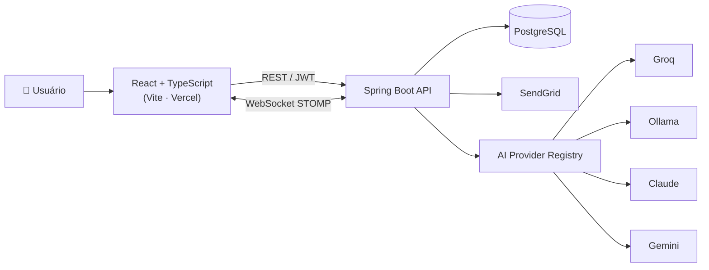

<h1 align="center">UDoc</h1>

<p align="center">
  <strong>Plataforma web com integração a Inteligência Artificial para pesquisa, geração e organização de conteúdo de treinamento e documentação corporativa.</strong>
</p>

<p align="center">
  <a href="https://udoc-onboarding.vercel.app"><strong>🔗 Acessar demo</strong></a>
</p>

<p align="center">
  
  
  
  
  
  
  
</p>

---

## Sobre o projeto

O **UDoc** nasceu de um problema real: empresas perdem conhecimento porque a documentação vive espalhada em PDFs, vídeos soltos e na cabeça das pessoas — e treinar alguém novo significa refazer tudo do zero.

A plataforma centraliza esse ciclo inteiro: criação de conteúdo, trilhas de aprendizagem, avaliação, certificação e acompanhamento — com uma camada de **IA generativa** que ajuda a pesquisar, redigir e organizar o material em vez de deixar tudo nas mãos de quem escreve.

Do ponto de vista técnico, o projeto é um exercício completo de **full stack**: API REST em Spring Boot com segurança JWT e auditoria automática por AOP, front-end React + TypeScript com editor rich text, comunicação em tempo real via WebSocket e uma **arquitetura de IA multi-provider** desenhada para não ficar refém de um único modelo.

> Este repositório é privado e serve como vitrine técnica. A demo pública está em [udoc-onboarding.vercel.app](https://udoc-onboarding.vercel.app).

---

## Destaques técnicos

### 🧠 Arquitetura de IA agnóstica de provedor

O núcleo mais interessante do projeto. Em vez de acoplar a aplicação a uma API específica, a camada de IA é construída sobre uma abstração (`AIProviderClient`) resolvida em tempo de execução por um **registry**:

```
AIController ──▶ AIService ──▶ AIProviderRegistry ──┬──▶ OpenAICompatibleClient ──▶ Groq / Ollama
                                                    ├──▶ ClaudeClient
                                                    └──▶ GeminiClient
                                     ▲
                            AIProviderKeyStore (chaves cifradas em banco)
```

- **Troca de modelo sem redeploy** — provedor, modelo e parâmetros são configurados pelo painel administrativo e persistidos no banco.
- **Cliente OpenAI-compatible** cobre de uma vez provedores que seguem o mesmo contrato (Groq para inferência de baixa latência, Ollama para execução local/self-hosted).
- **Chaves de API nunca em texto plano**: `EncryptionService` + `AIProviderKeyStore` guardam as credenciais cifradas.
- **Fallback e isolamento** — adicionar um novo provedor significa implementar uma interface, não reescrever regra de negócio.

### 🔍 Auditoria e permissões transparentes via AOP

Aspectos do Spring interceptam a camada de serviço para registrar `audit_log` em todo CRUD, validar permissões, disparar notificações e conceder XP — sem poluir as regras de negócio com código repetido.

| Aspect | Responsabilidade |
|---|---|
| `AuditAspect` | Log automático de criação/edição/exclusão |
| `PermissionAspect` | Checagem granular de permissões por grupo |
| `NotificationAspect` | Disparo de notificações em tempo real |
| `GamificationAspect` | Concessão de XP e progressão de ranking |

### ⚡ Tempo real e experiência de edição

WebSocket (STOMP + SockJS) para chat e notificações, editor **TipTap** com blocos de código, imagens redimensionáveis, vídeos do YouTube e anotação de imagens, exportação para PDF/XLSX e Kanban com drag-and-drop.

---

## Funcionalidades

<table>
<tr><td width="50%" valign="top">

**Conteúdo e aprendizagem**
- Trilhas de treinamento com conteúdo, questões e progresso
- Cards de conhecimento com quiz
- Catálogo pesquisável de materiais
- Certificados com templates personalizáveis
- Calendário e salas de treinamento
- Transcrição e gravação de sessões

</td><td width="50%" valign="top">

**Gestão e inteligência**
- Chat com IA e análise das conversas
- Painel de administração multiempresa
- Permissões granulares por grupo
- Gamificação: XP, ranking e conquistas
- Pesquisas de NPS e insights
- Auditoria completa do sistema
- Notificações em tempo real e por e-mail

</td></tr>
</table>

---

## Stack

| Camada | Tecnologias |
|---|---|
| **Back-end** | Java 21 · Spring Boot 3.5 · Spring Data JPA · Spring Security + JWT (jjwt) · Spring AOP · WebSocket · Spring Mail · Bean Validation · springdoc-openapi |
| **Front-end** | React 18 · TypeScript · Vite · Mantine UI · TipTap · Recharts · dnd-kit · Axios · React Router · STOMP/SockJS |
| **Banco de dados** | PostgreSQL |
| **Infra & qualidade** | Docker / Docker Compose · k6 (testes de carga e stress) · Vercel (front-end) · SendGrid (e-mail) |

---

## Arquitetura



---

## Estrutura do repositório

```
UDOC-Onboarding/
├─ backend/UDoc/            # API Spring Boot
│  ├─ src/main/java/com/system/UDoc/
│  │  ├─ config/            # CORS, WebSocket, aspects (auditoria, permissões, XP)
│  │  ├─ controller/        # Endpoints REST e WebSocket
│  │  ├─ entity/            # Modelo de domínio (JPA)
│  │  ├─ repository/        # Spring Data
│  │  ├─ service/           # Regras de negócio
│  │  └─ service/ai/        # Registry e clients dos provedores de IA
│  ├─ docker-compose.yml    # PostgreSQL local
│  └─ Dockerfile
├─ frontEnd/UDoc/           # SPA React + TypeScript
│  └─ src/
│     ├─ pages/             # Telas (admin, trilhas, ranking, auditoria…)
│     ├─ components/        # Componentes reutilizáveis
│     ├─ services/          # Clients HTTP
│     ├─ contexts/ hooks/   # Estado global e hooks
│     └─ types/
└─ load-test/               # Scripts k6 de carga e stress
```

---

## Como rodar localmente

**Pré-requisitos:** Java 21, Node 18+, Docker (ou um PostgreSQL já disponível).

### 1. Banco de dados

```bash
cd backend/UDoc
docker compose up -d
```

### 2. Back-end

```bash
cd backend/UDoc
cp .env.example .env     # preencha as variáveis
./mvnw spring-boot:run   # Windows: mvnw.cmd spring-boot:run
```

A API sobe em `http://localhost:8080` e a documentação Swagger fica em `http://localhost:8080/swagger-ui.html`.

> Há também os scripts `setup.sh` / `setup.bat` para preparar o ambiente em um passo.

### 3. Front-end

```bash
cd frontEnd/UDoc
cp .env.example .env.development
npm install
npm run dev
```

A aplicação fica disponível em `http://localhost:5173`.

---

## Variáveis de ambiente

**Back-end** (`backend/UDoc/.env`)

| Variável | Descrição |
|---|---|
| `DATABASE_URL` · `DATABASE_USERNAME` · `DATABASE_PASSWORD` | Conexão com o PostgreSQL |
| `PORT` | Porta da API |
| `CORS_ORIGIN` | Origem permitida para o front-end |
| `APP_FRONTEND_URL` · `APP_BACKEND_URL` | URLs públicas usadas em links e callbacks |
| `AI_KEY` | Chave do provedor de IA padrão |
| `AI_OLLAMA_URL` | Endpoint do Ollama (execução local ou via túnel) |
| `ENCRYPTION_KEY` | Chave usada para cifrar credenciais sensíveis |
| `SENDGRID_API_KEY` · `MAIL_FROM_ADDRESS` | Envio de e-mails transacionais |

**Front-end** (`frontEnd/UDoc/.env.development`)

| Variável | Descrição |
|---|---|
| `VITE_API_URL` | URL base da API |

---

## Testes de carga

Cenários de carga e stress escritos em [k6](https://k6.io/):

```bash
cd load-test
k6 run udoc_load_test.js
k6 run stress_test.js
```

Os resultados das execuções ficam versionados em `resultado.txt` e `resultado_stress.txt`.

---

## Deploy

- **Front-end:** Vercel, com build automático a cada push na `main` ([udoc-onboarding.vercel.app](https://udoc-onboarding.vercel.app)).
- **Back-end:** imagem Docker, com variáveis de ambiente injetadas pelo provedor de hospedagem.
- **Versionamento:** releases marcadas por tag semântica a cada deploy, permitindo rollback rápido para qualquer versão anterior.

---

## Roadmap

- [ ] Streaming de respostas da IA (SSE) no chat
- [ ] Geração automática de trilhas a partir de documentos enviados
- [ ] Cobertura de testes automatizados no back-end
- [ ] Pipeline de CI/CD com build e testes no GitHub Actions
- [ ] Modo offline/self-hosted completo com Ollama

---

## Autor

**Guilherme Diniz** — desenvolvedor full stack
[GitHub](https://github.com/guilhermediniz3)

---

<p align="center"><sub>Projeto pessoal desenvolvido para estudo e demonstração de arquitetura full stack com integração a modelos de linguagem.</sub></p>
